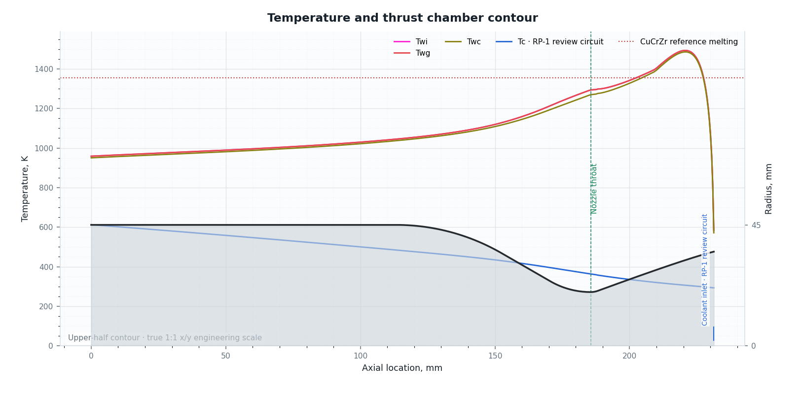

# 냉각제 입구와 유한 셀 벽면 온도의 결과 표시

2026-10-19, LPA 0.18.1b1 Beta 검토 기록.

## 표시의 의미

단상 리젠 채널의 벽면 결과는 각 열해석 셀에서 계산한 평균값이다. 그래프의
가로 좌표는 기존 열해석 지점 좌표를 유지한다. 특히 채널 입구를 포함한
첫 셀의 평균 온도는 입구 경계점 자체의 온도가 아니다. 발달 유동의 입구
열전달은 위치에 따라 급격히 변하므로, 첫 셀의 크기를 바꾸면 입구 쪽에
표시되는 평균 온도도 달라질 수 있다.
냉각제 bulk 온도는 해당 셀의 상류면 상태를 표시한다. 2상 비등과 방사
냉각에는 이번 단상 입구 구적을 적용하지 않으며 기존 station 해를 사용한다.

따라서 차가운 냉각제 입구 부근에서 벽면 온도가 내려가는 형태만으로
실제 벽면의 안전성이나 모델의 타당성을 판정하지 않는다. 재료 물성 범위,
벽과 냉각제의 온도 차, 비등 및 dryout 관련 적용 한계는 별도로 확인한다.

## UI와 내보내기 변경

- 새 결과가 `metadata.wall_sampling`을 제공하면 그래프 위에 유한 셀 평균과
  입구 경계점 온도의 차이를 설명하는 짧은 안내를 표시한다. 적용 불가
  지점이 있으면 계산 완료와 물리적 검증이 별개임을 같은 안내에서 명시한다.
- `metadata.coolant_entrance_diagnostics_by_segment`의 실제 입구 좌표에
  `Coolant inlet` 표시를 추가한다. 입구가 같은 회로는 표시 하나로 묶으며,
  별도 범례 항목을 추가하지 않는다. 역류에서는 노즐 출구가 입구일 수 있다.
- 벽면 온도와 냉각제 온도 배열, 가로 좌표 및 사용자의 곡선 평활화 선택은
  그대로 사용한다. 표시 개선을 위해 계산값이나 최고 온도를 바꾸지 않는다.
- 전체 지점 CSV의 `model_and_property_sources` JSON에 위 두 메타데이터를
  포함하여 셀 평균의 의미, 입구 좌표, 유동 방향 및 모델 진단을 추적할 수 있다.
  `sampled_cell_twg_min_k`와 `sampled_cell_twg_max_k` 열에는 셀 내부 구적
  표본에서의 가스측 벽면 온도 최솟값/최댓값을 기록한다. 이는 연속 영역의
  엄밀한 극값 경계나 실측값이 아니다. 표본이 없으면 빈칸으로 둔다.
- `invalid` 상태에서는 유효한 고체벽/냉각제 상태를 보장하지 못함을 명시하여,
  용융 등으로 가정이 무효화된 결과를 단순한 적용범위 주의와 구분한다.
- 활성 회로에서 재료 기준 용융 온도 초과가 실제 진단된 경우에만 해당
  기준 온도를 붉은 점선으로 표시한다. 예를 들어 `CuCrZr reference melting`
  표시를 사용하며, 같은 재료/온도의 중복 표시는 합친다. 임의의 기본
  허용 온도선을 추가하거나 계산 온도와 세로축 범위를 바꾸지 않는다.
- 이전 버전 결과에 해당 메타데이터가 없으면 새 입구 위치나 계산 기준을
  추정하여 표시하지 않는다.

## 검수

`tests/test_thermal_inlet_sampling_ui.py`는 원시 온도/좌표 유지, 정확한 입구
표시, 공유 입구 중복 제거, 표시 범위 밖 좌표 제외, CSV 진단 보존, 이전
결과 호환 및 1080×700 창에서 안내 줄바꿈을 확인한다. 관련 기존 2상 UI
시험과 함께 실행한다. 그래프는 Agg 렌더링으로도 확인한다.

## 제공된 RP-1 사례의 표시 확인

검토 시점 원본 SHA-256:
`b55b923eec14eaaa5778d31d1f6ddbd829221fd6fd2fc9ff53a64ec18c8ada33`.
원본 파일은 변경하지 않았다. 아래 그림은 중간 해상도 300셀 결과이며,
엔진/회로 이름은 공개 검토용 이름으로 대체했다. 곡선 평활화는 사용하지
않았다. 노즐 출구가 냉각제 입구임을 표시하고 계산된 온도 배열을 그대로
출력했다. 물리적 적용 상태는 `invalid`이다.

이 실행에서 첫 셀 평균 Twg는 583.612 K였으며, 셀 내부 32개 구적 표본의
Twg 범위는 309.608–696.452 K였다. 그래프의 끝점 평균을 정확한 입구점
온도로 읽을 수 없는 이유를 보여준다. 셀 평균 최고 Twg는 1493.126 K,
그 위치는 x=220.840 mm이며, 이 수치는 고체벽 가정의 유효성을 보장하지 않는다.
그림의 붉은 점선은 이 실행에서 초과가 진단된 CuCrZr 기준 용융 온도
1354.15 K이다. 34개 셀에서 기준을 넘는 표본이 있었고, base-wall 표본
최고값은 1496.965 K였다. 이를 고체벽 정상 상태의 유효한 해로 판정하지 않는다.
