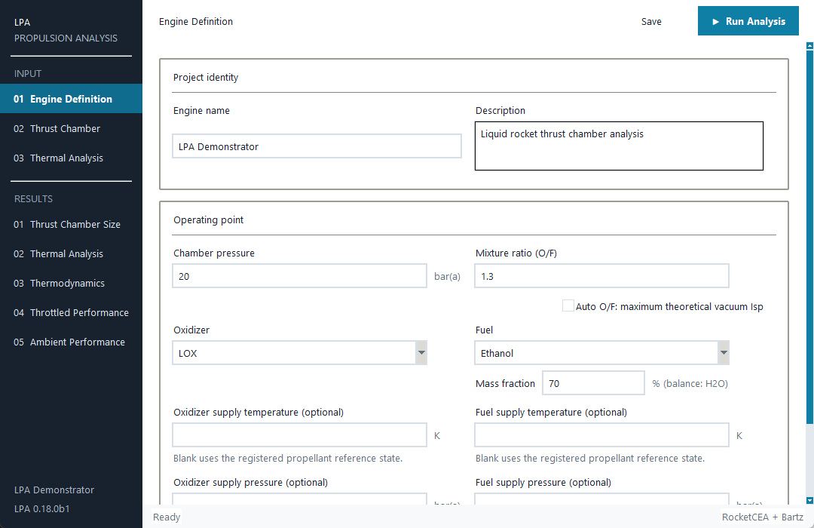
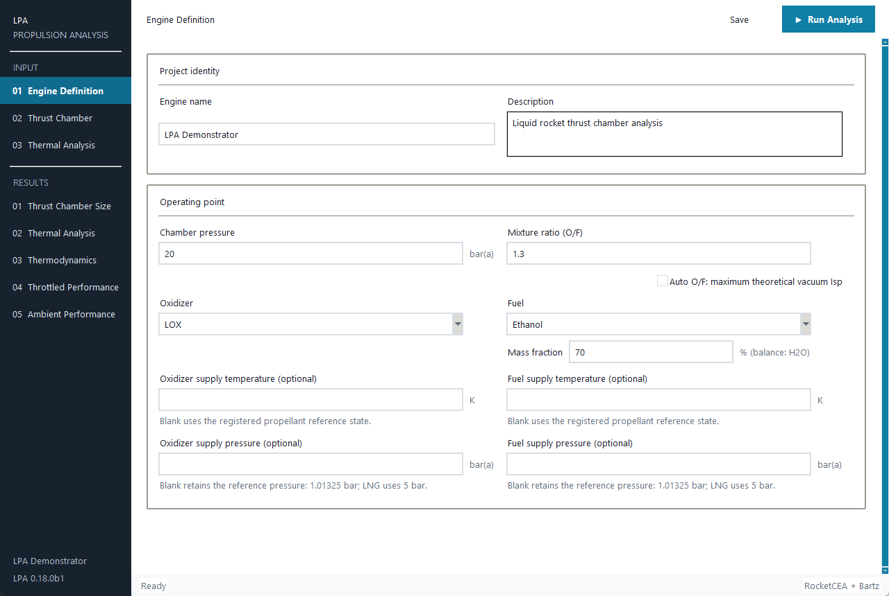

# UI layout and mixture diagnostics review — 0.18.0b1

Reviewed on 2026-10-19 with the local Windows Tk build. This records the
requested layout and numerical/physical-status presentation. The screenshots
were regenerated from the final 0.18.0b1 version stamp and reviewed layout code.

## Pc and O/F placement

Chamber pressure remains the left input and Mixture ratio (O/F) the right
input in **the same row**. In FieldGrid coordinates, both values occupy row 1;
Pc starts at column 0 and the O/F frame at column 3, each with value span 1.
The O/F entry is no longer a full-width field on a separate row.

Only the longer `Auto O/F: maximum theoretical vacuum Isp` checkbox uses the
shared row below both inputs. Its frame is FieldGrid row 2, column 0, span 5;
the checkbox is right-aligned inside it. Its text has no newline, wrapping,
abbreviation, or reduced font. The optimization status appears underneath
only when needed, wrapping to the actual available width.

The propellant selectors are top-aligned. Adding a concentration field under
Ethanol no longer vertically centers the shorter LOX cell below the Fuel
selector. Optional supply states remain paired in the same two-column grid.
This removes the separate full-width O/F row and the resulting unused vertical
space without reducing field sizes or changing their input meaning.

Measured default-font window coordinates:

| Client size | Pc / O/F entry top, screen px | Oxidizer / Fuel selector top, screen px | Auto checkbox required / rendered width |
|---|---|---|---|
| 1080×700 | 430 / 430 | 532 / 532 | 269 / 269 px |
| 1280×860 | 430 / 430 | 532 / 532 | 269 / 269 px |

The screen coordinates include the test window's location and Windows frame.
Their equality, rather than the absolute value, is the layout invariant.





## Thermal controls and result space

The existing two-column thermal controls are retained. `Auto (Beta)`,
`Pure fluids only`, and `Disabled` distinguish mixture/pure enablement. The
hint wraps to the panel width and explains the wet-wall assumption and
unpredicted CHF/dryout/post-dryout behavior. Beta's empirical mass-transfer
parameter is preserved in the project and model metadata; it is not presented
as a measured fuel property in the ordinary input controls.

Four additional axial diagnostics—local liquid-composition glide, F_TS, F_BG
and wet-wall assumption—use the existing horizontal scrollbar. Columns remain
readable instead of being compressed into unreadable widths. Old results
without those arrays show dashes; CSV leaves unknown values empty and keeps
true, false and unknown distinct. Unsolved wall temperatures remain empty
even when their known phase/glide/factors are available.

Outlet phase and property applicability appear below the existing circuit
table, preserving its established column layout. Numerical convergence,
available wall stations, complete coolant march, and physical/model
applicability remain separate. An unsupported correlation is labelled
`Outside supported model domain`, which does not imply that a finite EOS
equilibrium state is itself impossible. Wet-wall results explicitly state
that numerical completion does not validate a channel.

## Verification

`tests/test_auto_of_layout.py` checks 1080×700 and 1280×860 at Tk scaling
1.3333333333, 1.6666666667 and 2.0 (the Windows 96/120/144 dpi cases).
It verifies the full checkbox fits inside the visible canvas, retains one-line
text, Pc/O/F share the input row and horizontal order, and both propellant
selectors align despite the optional concentration field.

Targeted command:

```powershell
.venv-build\Scripts\python.exe -B -m pytest tests/test_mixture_boiling_ui.py tests/test_two_phase_ui.py tests/test_project_cfg.py tests/test_auto_of_layout.py -q -p no:cacheprovider --basetemp=tmp/pytest-mixture-ui-20261019-092145
```

Result: **31 passed** in 16.35 s. This includes settings mapping, CFG
roundtrip, legacy defaults without stale mixture/beta values, invalid
parameter rejection, JSON Boolean preservation, CSV diagnostics and model
metadata, unsolved station handling, and the result layout at 1080×700.

Additional existing UI/analysis integration regression run:

```powershell
.venv-build\Scripts\python.exe -B -m pytest tests/test_ui_smoke.py tests/test_release_ui_fixes.py tests/test_release_integration_fixes.py -q -p no:cacheprovider --basetemp=tmp/pytest-mixture-ui-regression-20261019-092625
```

Initial result: 91 passed and one pre-existing column-schema assertion failed
because the four new diagnostics were absent from its expected columns/empty
values. That expectation was updated, and the affected test passed separately
(1 passed, 3.76 s). The final layout/mixture-result checks after selector
alignment and the applicability wording change also passed:

```powershell
.venv-build\Scripts\python.exe -B -m pytest tests/test_mixture_boiling_ui.py::test_station_diagnostics_and_outlet_notes_remain_accessible_at_1080x700 tests/test_auto_of_layout.py -q -p no:cacheprovider --basetemp=tmp/pytest-mixture-ui-final-20261019-093745
```

Result: **7 passed** in 13.89 s. Full release-wide checks are recorded by the
release owner. These layout/serialization tests do not validate engine physics.
